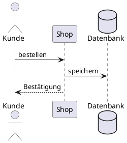

# clawbook-modeling — Modellieren mit PlantUML

Dieses Paket bringt PlantUML und Graphviz mit. Damit beschreiben Sie
UML-Diagramme als Text und lassen sie als Bild erzeugen — ohne
Internet, alles läuft im Container.

## Was drin ist

| Werkzeug | Version | Befehl | Herkunft |
|---|---|---|---|
| PlantUML (MIT-Fassung) | 1.2026.8 | `plantuml` | Herausgeber, unter `/opt/plantuml` |
| Graphviz | 2.42 | `dot` | Debian |
| Java-Laufzeit | 25 | (für PlantUML) | Debian |

VS-Code-Erweiterungen im Container: PlantUML (`jebbs.plantuml`).

## Installieren

Das Paket kommt mit dem Kurs `kurs-swe`. Einzeln installieren Sie es
auf einem dieser Wege:

- **Unter Windows** im Verwaltungs-Skript: PowerShell öffnen und den
  Befehl von der Startseite von clawbook ausführen:

  ```powershell
  irm https://raw.githubusercontent.com/schlingensiepen/clawbook-lehre/main/get-clawbook.ps1 | iex
  ```

  Dann Menüpunkt **[11] Kurse und Technikpakete**, `t` und die Nummer
  von `clawbook-modeling`.
- **Im Container** (Terminal, siehe „Erste Schritte“):

  ```bash
  clawbook pakete add clawbook-modeling
  ```

Ausführlich beschreibt das die Seite
[Kurse und Technikpakete](https://github.com/schlingensiepen/clawbook-lehre/blob/main/docs/kurse-und-pakete.md).
Diese Doku zeigt Ihnen im Container auch `clawbook pakete info clawbook-modeling`.

## Erste Schritte

**Wo Sie tippen:** Alle Befehle auf dieser Seite tippen Sie im
Terminal des Containers, nicht in Windows. Am einfachsten in VS Code:
VS Code über das Verwaltungs-Skript (**[9] VS Code starten**) oder den
Startmenü-Eintrag „clawbook VS Code“ öffnen, dann im Menü **Terminal →
Neues Terminal** (englisch *Terminal → New Terminal*). Weitere
Terminals öffnet das Plus-Symbol im Terminalbereich. Alternativ in
PowerShell `ssh clawbook`. Ihre Projekte legen Sie unter `~/source` an,
dem Projektordner in Ihrem Home (`~` steht für `/home/student`).
Begriffe wie Container, Home oder VSCodePack erklärt das
[Glossar](https://github.com/schlingensiepen/clawbook-lehre/blob/main/docs/README.md#begriffe).

Ein Sequenzdiagramm als Text, in `~/source/hallo-uml/bestellung.puml`:



Bild erzeugen:

```bash
cd ~/source/hallo-uml
plantuml bestellung.puml           # erzeugt bestellung.png
plantuml -tsvg bestellung.puml     # erzeugt bestellung.svg
```

**In VS Code:** Öffnen Sie die `.puml`-Datei und drücken Sie `Alt+D`.
Die Vorschau erscheint daneben und folgt jeder Änderung. Exportieren
geht über die Befehlspalette (`Strg+Umschalt+P`), **PlantUML: Export
Current Diagram**.

Graphviz allein, für Graphen:

```bash
echo 'digraph G { Start -> Ende }' > graph.dot
dot -Tpng graph.dot -o graph.png
```

## Wer macht was

**Das erledigt clawbook:** PlantUML, Graphviz und Java installieren.
Im Kurs `kurs-swe` stellt das VSCodePack die Erweiterung so ein, dass
sie lokal mit dem mitgelieferten PlantUML rendert
(`plantuml.render: Local`); Ihre Diagramme verlassen den Container
nicht.

**Das tun Sie selbst:** Diagramme als `.puml`-Dateien schreiben und
rendern. Das Bild legt `plantuml` neben die `.puml`-Datei (im Beispiel
`~/source/hallo-uml/bestellung.png`); in VS Code öffnen Sie es per
Klick im Explorer.

**Falls die Automatik nicht geht:** Ohne Kurs (Paket einzeln
installiert) tragen Sie in den VS-Code-Einstellungen
`"plantuml.render": "Local"` und
`"plantuml.jar": "/opt/plantuml/plantuml.jar"` ein. Fehlt die
Erweiterung, in der Erweiterungsansicht (`Strg+Umschalt+X`) „PlantUML"
(Herausgeber jebbs) suchen und **In SSH: clawbook installieren**.

## Wenn etwas nicht geht

- **„Syntax Error?" im Bild** — PlantUML zeigt die fehlerhafte Zeile
  rot. Häufig fehlt `@startuml` oder `@enduml`.
- **Die Vorschau in VS Code bleibt leer** — Einstellung
  `plantuml.render` muss `Local` sein (siehe oben); danach VS Code neu
  laden.
- **„Dot executable … does not exist"** bei Klassen- oder
  Komponentendiagrammen — Graphviz fehlt oder ist beschädigt:
  `sudo apt-get install --reinstall graphviz`.
- **Umlaute fehlen im Bild** — die `.puml`-Datei muss als UTF-8
  gespeichert sein (Standard in VS Code).
